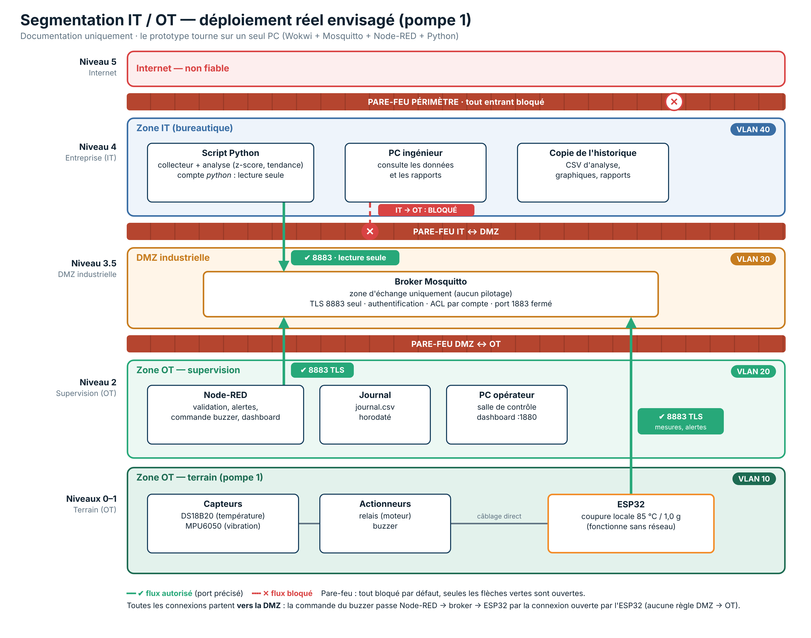

# Segmentation IT / OT — déploiement réel envisagé

> **Documentation uniquement.** Le prototype tourne sur un seul PC (Wokwi + Mosquitto + Node-RED + Python).
> Cette section décrit comment le système serait protégé s'il était installé dans une vraie usine.

## 1. Zones et VLAN (modèle Purdue)

| Niveau (Purdue) | Zone | VLAN | Éléments |
|---|---|---|---|
| 0–1 | OT — terrain | 10 | ESP32, DS18B20, MPU6050, relais, buzzer |
| 2 | OT — supervision (salle de contrôle) | 20 | Node-RED (validation, alertes, commande buzzer, dashboard), journal horodaté, PC opérateur |
| 3.5 | DMZ industrielle | 30 | Broker Mosquitto (TLS 8883, authentification, ACL) |
| 4 | IT — bureautique | 40 | Script Python (collecteur + analyse), PC ingénieur, copie de l'historique |
| 5 | Internet | — | Aucun accès entrant |

- Le **VLAN 1** (VLAN par défaut) n'est pas utilisé.
- Un VLAN sépare les réseaux, mais c'est le **pare-feu entre les VLAN** qui décide qui peut parler à qui.

### Justification des choix

| Élément | Zone | Pourquoi |
|---|---|---|
| ESP32, capteurs, actionneurs | OT terrain | Ce sont les équipements physiques de la pompe |
| Node-RED | OT supervision | Il **pilote** (commande du buzzer, décision d'alerte) : un outil de conduite reste en OT |
| PC opérateur | OT supervision | Il est en salle de contrôle, dans le même VLAN que Node-RED |
| Journal | OT supervision | Il est écrit par Node-RED ; l'IT n'en reçoit qu'une copie |
| Broker | DMZ | Zone d'échange entre OT et IT : chacun s'y connecte, personne ne traverse directement |
| Script Python | IT | Analyse uniquement ; compte `python` en lecture seule |

**Pourquoi le broker n'est pas en OT :** l'IT devrait alors entrer dans l'OT pour lire les données, ce qui est interdit (un poste de bureau infecté aurait un chemin vers les machines).
Si le broker tombe, la **sécurité reste assurée** : l'ESP32 coupe la pompe seul (test T5 : coupure locale à 89,3 °C sans broker). On perd seulement la supervision.

## 2. Règles du pare-feu

Par défaut, **tout est bloqué** ; on n'ouvre que le strict nécessaire.

| Source | Destination | Port | Décision |
|---|---|---|---|
| ESP32 (VLAN 10) | Broker (VLAN 30) | 8883 (MQTT TLS) | ✅ Autorisé |
| Node-RED (VLAN 20) | Broker (VLAN 30) | 8883 (MQTT TLS) | ✅ Autorisé |
| PC opérateur (VLAN 20) | Node-RED (VLAN 20) | 1880 | ✅ Même VLAN (pas de pare-feu traversé) |
| Python (VLAN 40) | Broker (VLAN 30) | 8883 (MQTT TLS) | ✅ Autorisé, lecture seule (ACL) |
| PC ingénieur / IT (VLAN 40) | OT (VLAN 10 et 20) | tous | ❌ Bloqué |
| Internet | toutes les zones | tous | ❌ Bloqué |

**Toutes les connexions partent vers la DMZ, jamais l'inverse.** La commande du buzzer passe Node-RED → broker → ESP32, par la connexion que l'ESP32 a lui-même ouverte : aucune règle DMZ → OT n'est nécessaire.

## 3. Lien avec IEC 62443

IEC 62443 est la norme de cybersécurité des systèmes industriels.

- **Zones** : groupes d'équipements de même niveau de confiance → nos VLAN (terrain, supervision, DMZ, IT).
- **Conduits** : seuls passages autorisés et contrôlés entre zones → les flux 8883 TLS à travers les pare-feux.

| Exigence fondamentale | Mise en œuvre dans le projet |
|---|---|
| Identifier et authentifier | Comptes MQTT avec mot de passe, refus de l'anonyme (test T2) |
| Contrôler l'usage | ACL : compte `python` en lecture seule (test T3) |
| Intégrité | TLS, validation des mesures |
| Confidentialité | TLS (AES-256-GCM) |
| Flux de données restreints | VLAN + pare-feux, IT → OT bloqué |
| Réagir aux événements | Journal horodaté, alertes |
| Disponibilité | Coupure locale sans réseau (test T5), reconnexion automatique |

## 4. Prototype vs usine réelle

| | Prototype | Usine réelle |
|---|---|---|
| Réseau | Un seul PC, tout en local | VLAN 10 / 20 / 30 / 40 séparés |
| Filtrage | Aucun pare-feu entre composants | 3 pare-feux, tout bloqué par défaut |
| Broker | `localhost:8883` | Serveur dédié en DMZ |

**Amélioration possible :** un broker local en OT + un **pont (bridge) Mosquitto** qui recopie les messages vers le broker de la DMZ. La supervision continue même si la DMZ tombe, et le pont part de l'OT vers la DMZ (règle respectée).
